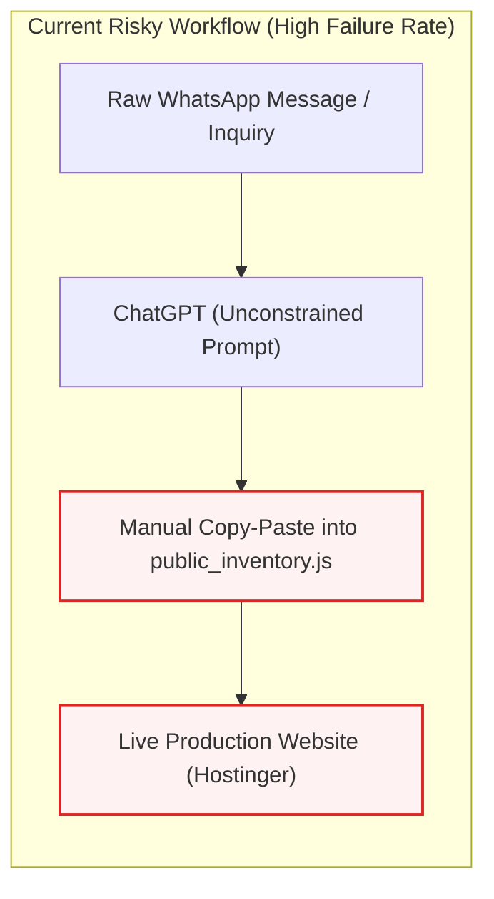
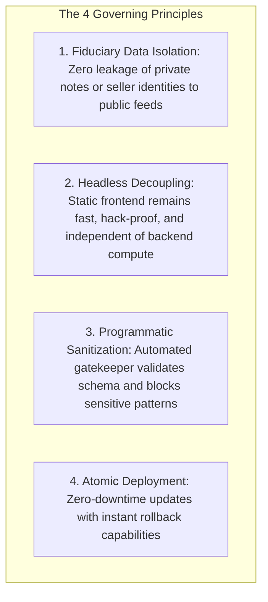
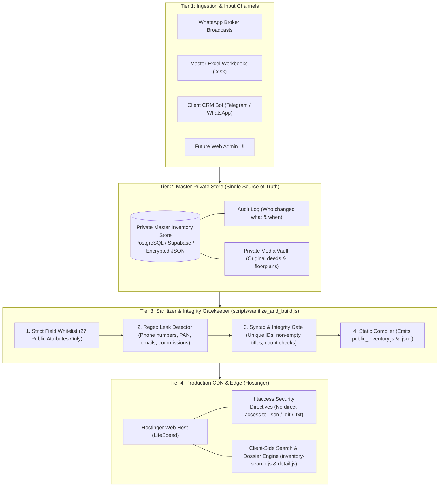
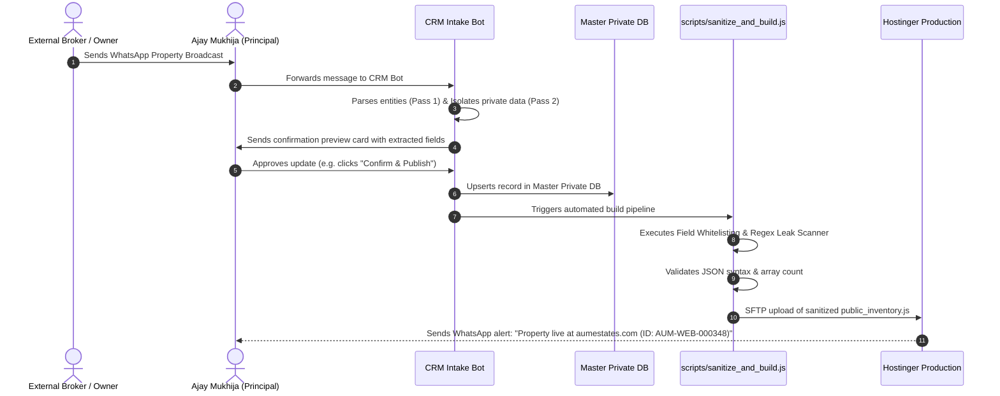

# AUM ESTATES — Backend System Specification & Strategic Architecture Roadmap

**Document Version:** 1.0.0  
**Effective Date:** October 2026  
**Target Platform:** AUM ESTATES Private Advisory (`aumestates.com`)  
**Author:** Technical Architecture & Engineering Team  
**Confidentiality:** Internal / Advisory Proprietary  

---

## 1. Executive Summary & Problem Diagnosis

### 1.1 Business Context
AUM ESTATES is an independent luxury real estate advisory founded in 2002 by **Ajay Mukhija** with physical headquarters in **C-210 Nirvana Courtyard, Sector 50, Gurgaon**. The brokerage represents high-value mandates (residential condominiums, penthouses, independent builder floors, HSVP plots, and commercial assets) across Golf Course Road, DLF Phase 1–5, Nirvana Country, Sohna Road, and Dwarka Expressway.

### 1.2 The Current Operational Vulnerability
Currently, when new property inquiries, listings, or price adjustments arrive via WhatsApp, the workflow consists of feeding the raw conversational text directly into ChatGPT and having it manually edit the single monolithic inventory file (`public_inventory.js` / `.json`).



**Why this workflow is critical to replace immediately:**
1. **Silent Syntax Failures**: If ChatGPT produces a single unescaped quote (`"`), an unescaped newline, or a trailing comma, `public_inventory.js` fails to parse on Line 1. Because the frontend relies on this file, **search, filtering, and all 347 property dossiers crash site-wide**.
2. **Catastrophic Privacy & Financial Leaks**: Raw WhatsApp broker messages contain seller telephone numbers, minimum negotiable floor prices, commission cuts, and cheque/cash ratios. Without programmatic sanitization, ChatGPT will eventually copy private seller notes directly into public listings.
   * *Real-world proof*: An initial automated scan of the live database uncovered 4 listings where `"; 1% brokerage"` and `"; brokerage paid"` had been inadvertently published to the live website.
3. **Array Truncation & Hallucination**: When workbooks exceed token output limits, LLMs routinely truncate output (e.g., returning 40 items and omitting 300), silently erasing the majority of the firm's portfolio from the web.
4. **CRM Bot Disconnect**: The client is actively developing a CRM bot to manage inventory across multiple channels. Without a formal backend specification, the bot will lack a structured API contract and fail to synchronize properly.

---

## 2. Core Architectural Principles



1. **Strict Data Isolation**: The system maintains a complete separation between the **Private Master Database** (storing owner identities, phone numbers, commission agreements, and internal source messages) and the **Public Web Feed** (storing only marketing-approved specs and public advisory text).
2. **Headless Decoupling**: The customer-facing website remains a lightning-fast, static frontend on Hostinger. It never communicates directly with a dynamic database, protecting the site against SQL injection, server load spikes, and plugin exploits.
3. **Zero-Trust Ingestion**: Every property update—whether from the CRM bot, an Excel upload, or manual entry—must pass through an automated validator and sanitization gatekeeper before it can ever reach production.
4. **Atomic Compilation**: Inventory changes are compiled into versioned, validated bundles. If validation fails, production remains untouched and the previous healthy version continues serving traffic.

---

## 3. Target 4-Tier Backend Architecture



---

## 4. Tier-by-Tier Technical Specifications

### 4.1 Tier 1: Ingestion & CRM Bot Interface
The CRM bot being developed by the client acts as the digital intake assistant. Its job is to ingest unstructured conversational data and normalize it into structured draft records.

#### Requirements for the CRM Bot:
1. **Two-Pass Extraction**:
   * *Pass 1 (Entity Extraction)*: Extract structural parameters: Location, Project Name, Configuration (e.g. `4 BHK`), Area, Price, Transaction (`Sale` vs `Rent`), Facing, Road Width.
   * *Pass 2 (Privacy Separation)*: Explicitly extract and quarantine private entities: Owner Name, Owner Mobile, Minimum Negotiable Price, Brokerage/Commission Terms, Source Broker/Group Name.
2. **Human-in-the-Loop Confirmation**:
   * The bot must **never** publish directly to the website without human confirmation.
   * It should send a summary back to Ajay Mukhija or senior staff on WhatsApp/Telegram:
     > *"New listing parsed: DLF Park Place 4 BHK, Sector 54. Asking ₹9.25 Cr. Owner: [Redacted for Web]. Reply 'PUBLISH' to push to website or 'EDIT' to modify."*

---

### 4.2 Tier 2: Master Private Database (Source of Truth)
A centralized private database must store the full lifecycle of every property.

#### Recommended Stack:
* **Option A (Cloud PostgreSQL via Supabase or Neon)**: Highly recommended. Provides built-in Row-Level Security (RLS), instant REST/GraphQL APIs for the CRM bot, and automated backups.
* **Option B (AirTable / Master Excel on OneDrive)**: Acceptable interim solution if the client refuses database software. Requires strict schema enforcement on column names.

#### Data Model Specification:
Every property is stored as a Master Document containing two clearly delimited sections:

```json
{
  "property_id": "AUM-WEB-000348",
  "status": "Available",
  
  "_private_broker_metadata": {
    "owner_name": "Col. R. K. Verma (Retd.)",
    "owner_contact": "+91 98110 XXXXX",
    "owner_email": "rkverma@example.com",
    "internal_floor_price": 87500000,
    "cheque_cash_ratio": "70:30",
    "broker_commission_percent": 1.0,
    "source_group": "Golf Course Luxury Realtors Syndicate",
    "source_message_raw": "Belaire 4bhk vacant keys in hand call 98110XXXXX...",
    "title_deed_verified": true,
    "hsvp_encumbrance_status": "Clear - Scanned Deed on File",
    "internal_notes": "Seller moving to London in December; urgent sale."
  },

  "public_listing_data": {
    "project_name": "DLF The Belaire",
    "locality": "Golf Course Road",
    "sector": "Sector 54",
    "city": "Gurgaon",
    "micro_location": "Golf Course Road",
    "property_type": "Apartment",
    "transaction_type": "Sale",
    "listing_title": "DLF The Belaire 4 BHK Luxury Condominium",
    "configuration": "4 BHK + Servant",
    "bedrooms": "4",
    "bathrooms": "5",
    "area_value": 3065,
    "area_unit": "Sq Ft",
    "facing": "North-East",
    "road_width": "60 m",
    "price_value": 9.25,
    "price_unit": "Cr",
    "price_text": "₹9.25 Cr",
    "rent_value": null,
    "rent_unit": null,
    "key_features": "Higher floor; Aravalli green facing; 2 dedicated basement parking slots; modular kitchen.",
    "public_description": "Exclusive 4 BHK + Servant luxury residence in DLF The Belaire, Sector 54. Positioned on an upper floor with uninterrupted panoramic views of the Aravalli biodiversity corridor.",
    "public_features": "Clubhouse Access; Swimming Pool; Multi-tier 24/7 Security; Power Backup",
    "image_label": "Project Photo",
    "slug": "dlf-the-belaire-sector-54-4-bhk-3065-sq-ft",
    "url": "https://aumestates.com/properties/detail.html?id=AUM-WEB-000348"
  }
}
```

---

### 4.3 Tier 3: The Sanitizer & Integrity Gatekeeper
This is the **fiduciary firewall**. The repository already contains the foundational implementation at [`scripts/sanitize_and_build.js`](file:///Users/udaymukhija/Aum_estates/scripts/sanitize_and_build.js).

#### Gatekeeper Operational Rules:
1. **Whitelist Filtering**: The pipeline iterates over every record and explicitly discards any key not in `ALLOWED_PUBLIC_FIELDS`. Even if the CRM bot accidentally attaches `owner_contact`, the compiler drops it before writing the file.
2. **Regex Leak Scanning**:
   * Phone Numbers: Scans all string values for 10-digit Indian numbers (`(?:\+91[\s-]?)?[6-9]\d{9}`). Allowed exception: the firm's official line (`9873813595`).
   * Financial terms: Detects `"brokerage"`, `"commission"`, `"cheque"`, `"white/black"`.
   * Personal identifiers: Detects PAN formats (`[A-Z]{5}[0-9]{4}[A-Z]{1}`) and email patterns.
3. **Integrity Validation**:
   * Confirms `property_id` uniqueness.
   * Enforces minimum total listing thresholds (e.g. if the current database has 347 listings and the incoming update has only 40, the script aborts immediately to prevent truncation accidents).
4. **Compilation Output**:
   * Emits [`AUM_ESTATES_Website_For_Hostinger/data/public_inventory.json`](file:///Users/udaymukhija/Aum_estates/AUM_ESTATES_Website_For_Hostinger/data/public_inventory.json)
   * Emits [`AUM_ESTATES_Website_For_Hostinger/data/public_inventory.js`](file:///Users/udaymukhija/Aum_estates/AUM_ESTATES_Website_For_Hostinger/data/public_inventory.js) (`window.AUM_PUBLIC_INVENTORY = [...]`)

---

### 4.4 Tier 4: Production Deployment & Edge Security (Hostinger)
The compiled static assets are deployed to Hostinger.

#### Hardened Security Rules Configured in [`.htaccess`](file:///Users/udaymukhija/Aum_estates/AUM_ESTATES_Website_For_Hostinger/.htaccess):
* **Directory Indexing Block**: `Options -Indexes` stops scrapers from browsing file trees.
* **File Quarantine**: Direct HTTP requests to `.txt`, `.md`, `.bak`, `.backup`, and `.git` return `403 Forbidden`.
* **Transport Security**: Automatic 301 redirection from `http://` to `https://` with HSTS preloaded (`max-age=31536000`).
* **Frame Protection**: `X-Frame-Options: SAMEORIGIN` prevents clickjacking.
* **MIME Sniffing Block**: `X-Content-Type-Options: nosniff`.
* **Asset Cache Rules**:
  * Inventory JS/JSON: Cached for **10 minutes** so price updates propagate to clients quickly.
  * Images and CSS: Cached for **30 days** to ensure blistering performance.

---

## 5. End-to-End Ingestion & Publishing Workflow



---

## 6. Comprehensive Implementation Roadmap

### Phase 1: Hardened Guardrails (Immediate / Completed)
* [x] **Deploy Security Directives**: Shipped production [`.htaccess`](file:///Users/udaymukhija/Aum_estates/AUM_ESTATES_Website_For_Hostinger/.htaccess) with HSTS, clickjacking prevention, directory index blocking, and sensitive file quarantine.
* [x] **Scrub Brokerage Leaks**: Cleaned live public inventory database of historical brokerage comments (`AUM-WEB-000211`, `246`, `247`, `249`).
* [x] **Build Automated Sanitizer Script**: Shipped and verified [`scripts/sanitize_and_build.js`](file:///Users/udaymukhija/Aum_estates/scripts/sanitize_and_build.js).
* [x] **Search Engine Overhaul**: Fixed taxonomy and corridor clustering for DLF Builder Floors (61 records), Extension/SPR (61 records), and Dwarka Expressway (8 records).

---

### Phase 2: CRM Bot Bridge & Master Private Store (Weeks 1–3)
* [ ] **Define Schema Contract**: Share Section 4.2 of this specification with the CRM bot developer.
* [ ] **Provision Private Database**: Set up a managed PostgreSQL database (e.g., Supabase free tier or Neon) to hold the private records.
* [ ] **Implement Bot Approval Loop**: Ensure the bot requires human approval (Ajay Mukhija or senior advisor) before triggering web publication.
* [ ] **Automate Local Compiler**: Connect the CRM bot's approved output to run `node scripts/sanitize_and_build.js`.

---

### Phase 3: Automated Continuous Deployment (CI/CD) (Weeks 4–6)
* [ ] **GitHub Actions / Webhook Pipeline**:
  * Set up a GitHub repository action or lightweight webhook listener.
  * When the CRM bot commits or posts a sanitized inventory payload, the action runs automated tests:
    1. `node scripts/sanitize_and_build.js`
    2. Automated search test suite (confirming 18/18 tests pass)
    3. Automated SFTP deployment of `public_inventory.js` to Hostinger via encrypted SSH keys.
* [ ] **Alerting**: Configure bot to ping the internal Telegram/WhatsApp channel with confirmation and live URL link upon successful deployment.

---

### Phase 4: Long-Term Enterprise Capabilities (Month 2+)
* [ ] **Dynamic PDF Dossier Generation**: Automatically compile verified PDF investment memorandums on the fly from sanitized property data when a client requests particulars.
* [ ] **Automated Reverification Bot**: Every 90 days, the CRM bot prompts the internal advisory desk:  
  *"Property AUM-WEB-000124 (DLF Park Place 3 BHK) has been listed for 90 days. Confirm still available or mark as Sold."*
* [ ] **Private Shortlist Links**: Generate password-protected custom dossier collections for specific HNW family offices.

---

## 7. Developer & Client Operational Runbook

### How to Safely Update Property Inventory Today
Until the CRM bot pipeline is fully integrated into Git/CI, follow this **non-negotiable procedure** for all inventory updates:

```bash
# Step 1: Place updated raw data or edited JSON in data directory
# Step 2: Run the automated sanitizer and integrity auditor
node scripts/sanitize_and_build.js

# Step 3: Verify zero warnings and zero leak alerts are reported
# Step 4: Run the search verification test suite
node -e '
const fs = require("fs");
const searchCode = fs.readFileSync("AUM_ESTATES_Website_For_Hostinger/data/inventory-search.js", "utf8");
const publicCode = fs.readFileSync("AUM_ESTATES_Website_For_Hostinger/data/public_inventory.js", "utf8");
let count = 0;
const doc = { querySelectorAll: () => [], getElementById: (id) => id === "result-count" ? { set textContent(v) { count = Number(v); } } : { innerHTML: "", set textContent(){} }, addEventListener: (e, cb) => cb() };
const win = { document: doc, addEventListener: () => {} };
eval(publicCode);
win.AUM_PUBLIC_INVENTORY = window.AUM_PUBLIC_INVENTORY;
new Function("window", "document", "location", searchCode)(win, doc, { search: "?category=builder-floor", pathname: "/properties/index.html" });
console.log("Builder Floors Verified:", count >= 50 ? "PASS (" + count + ")" : "FAIL");
'

# Step 5: Upload ONLY the compiled public_inventory.js to Hostinger via SFTP
```

### Emergency Rollback Protocol
If any corrupt file is accidentally uploaded:
1. Revert to the last Git commit or backup snapshot:
   ```bash
   git checkout HEAD~1 -- AUM_ESTATES_Website_For_Hostinger/data/public_inventory.js
   ```
2. Re-upload `public_inventory.js` to Hostinger.
3. The site recovers instantly without requiring server restarts or database migrations.

---

## 8. Summary Checklist for Engineering Alignment

| Architectural Checkpoint | Status | Responsible Party |
| :--- | :---: | :--- |
| **Kill ChatGPT Manual File Editing** | **Immediate Priority** | Client & Agency Principal |
| **Implement Field Whitelist in CRM Bot** | **Mandatory** | CRM Bot Developer |
| **Sanitizer Script Integration** | **Active & Verified** | Web Engineering Team |
| **Hostinger Server Security ([`.htaccess`](file:///Users/udaymukhija/Aum_estates/AUM_ESTATES_Website_For_Hostinger/.htaccess))** | **Deployed** | Web Engineering Team |
| **Hostinger Account 2FA & SFTP Enforcement** | **Pending User Action** | Client Account Admin |

---
*This document serves as the permanent architectural reference for AUM ESTATES digital engineering. All backend modifications must adhere strictly to the protocols outlined herein.*
